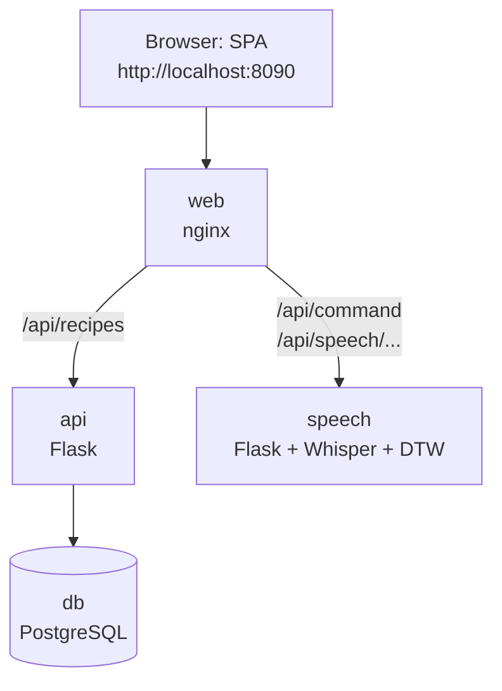
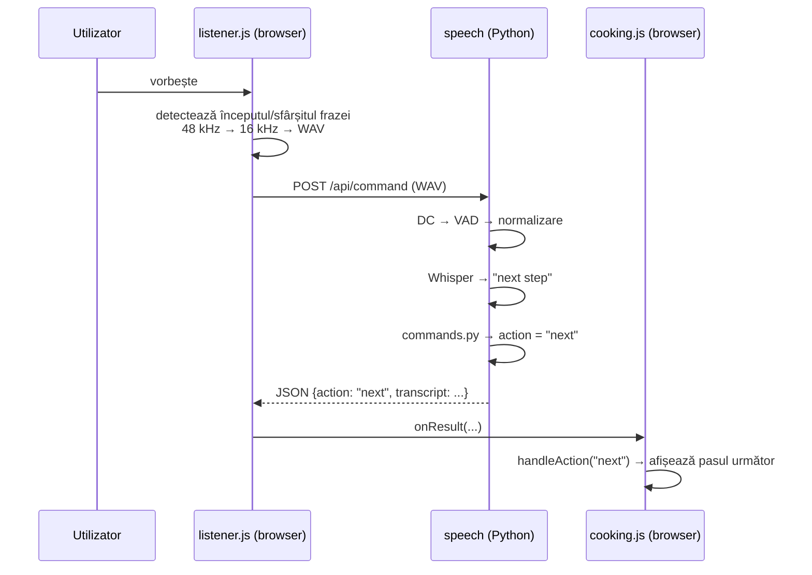

# 01 Arhitectura generală

Înapoi la [[00 Start aici]]

## Pe scurt
Aplicația e împărțită în **4 servicii**, fiecare în containerul lui Docker (vezi [[02 Docker Compose]]):

| Serviciu | Ce face | Notiță |
|---|---|---|
| `web` | servește paginile HTML/CSS/JS și „pasează” cererile `/api/...` mai departe | [[03 Frontend web]] |
| `api` | adaugă, citește, editează și șterge rețete | [[06 Backend API și PostgreSQL]] |
| `db` | baza de date PostgreSQL | [[06 Backend API și PostgreSQL]] |
| `speech` | primește audio și întoarce o comandă | [[07 Serviciul speech]] |

## Drumul unei comenzi vocale
Exemplu: în modul de gătit spui „next step”.

1. **Browserul** ascultă continuu și taie fraza → [[04 Ascultarea continuă (listener)]]
2. **Python** curăță semnalul → [[08 Preprocesare și VAD]]
3. **Python** recunoaște comanda:
   - metoda A, Whisper → [[09 Whisper și interpretarea comenzilor]]
   - metoda B, MFCC + DTW → [[10 MFCC și DTW]]
4. **Browserul** execută acțiunea → [[05 Modul de gătit]]

## Decizii importante
- **Nu folosim recunoașterea vocală din browser** (Web Speech API). Toată prelucrarea e în Python, scrisă de noi, ca să se lege de materie.
- **Fără framework frontend** (React etc.). HTML + CSS + JavaScript simplu, ca să fie ușor de explicat.
- **Servicii separate în Docker**: fiecare parte se poate porni, opri și explica separat.
- **Spectrogramele nu apar în interfață.** Sunt detalii tehnice, generate doar în Python pentru documentație → [[12 Evaluare și grafice]].
- **Totul rulează local**, demo-ul se face pe laptop.
