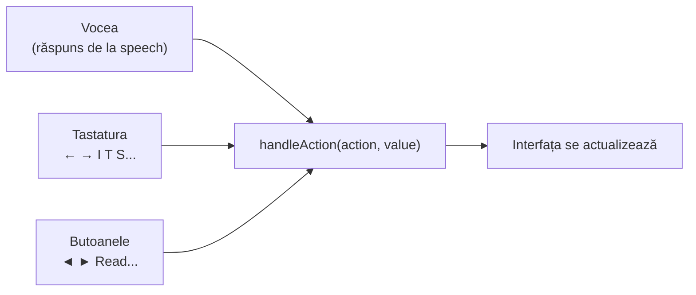

# 05 Modul de gătit

Înapoi la [[00 Start aici]] · vezi și [[03 Frontend web]], [[04 Ascultarea continuă (listener)]]

Fișier: `web/public/cooking.js` · adresă: `#/cook/:id`

## Ideea principală
**Toate acțiunile trec printr-o singură funcție:** `Cooking.handleAction(action, value)`.

**Butoanele** au un atribut `data-action` (de exemplu `<button data-action="next">`). Un singur handler de click, pus pe toată pagina, citește atributul și apelează `handleAction`. Nu e nevoie de câte o funcție pentru fiecare buton.

Interfața nu știe și nu îi pasă de unde vine comanda. E exact legătura **comandă → acțiune în interfață** din lanțul temei.

## Ecranul
- **Cardul pasului:** text foarte mare (~40–50 px, citibil de la 2 m), „Step 2 of 6” și o bară de progres.
- **◄ ►** pentru pași. „Next” pe ultimul pas duce la ecranul **„Bon appétit! 🎉”**.
- **Timer-ul:**
  - dacă pasul are timp definit, apare butonul „⏱ Start 10 min”
  - pornit, arată numărătoarea inversă
- **Butoanele de jos:** Ingredients, Read, Help.
- **Indicatorul de microfon** din dreapta sus.
- **Feedback** după fiecare comandă: un mesaj scurt jos („✓ Next step”) și o notă gri „I heard: …”.

## Acțiunile

| Acțiune | Ce face |
|---|---|
| `next` / `previous` | pasul următor / anterior. `previous` cu un panou deschis îl închide. |
| `repeat` | cardul clipește și pasul se citește cu voce |
| `read` | citește pasul cu `speechSynthesis` (vocea browserului) |
| `ingredients` / `help` | deschide un panou peste ecran |
| `close` | închide panoul |
| `timer` | pornește timer-ul: cu `value` (minute) sau, fără număr, timpul pasului curent |
| `stop_timer` | oprește timer-ul sau alarma |
| `exit` | înapoi pe Home |
| `unknown` | **ignorată în liniște**: apare doar „I heard: …” |

`unknown` e ignorată pentru că microfonul ascultă tot timpul. Altfel ecranul s-ar umple de erori când vorbești normal în bucătărie.

## Timer-ul și alarma
- Un singur timer activ; unul nou îl înlocuiește pe cel vechi.
- La final: **bip de 880 Hz** generat cu Web Audio (oscilator sinusoidal), la fiecare secundă, iar ecranul clipește.
- **Oprire automată după 1 minut** (`ALARM_MAX_MS`). Bipurile tac, dar rămâne „⏱ Time's up!” cu roșu și butonul *Dismiss*.

## Scurtături de tastatură (pentru test, fără voce)
← → pași · **I** ingrediente · **H** ajutor · **Esc** închide · **T** timer · **S** stop · **R** citește

## Curățenie la ieșire
`Cooking.stop()` (apelat de router) oprește microfonul, timer-ul, alarma și citirea cu voce. Fără el, un timer ar continua să sune în fundal după ce ai ieșit din pagină.
