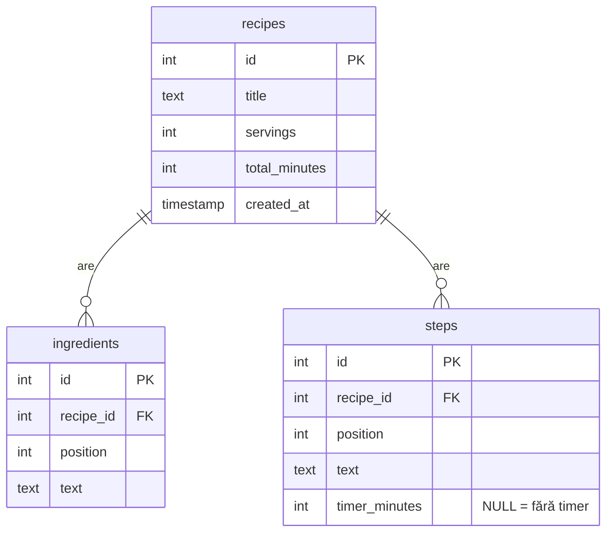

# 06 Backend API și PostgreSQL

Înapoi la [[00 Start aici]] · vezi și [[02 Docker Compose]], [[03 Frontend web]]

Fișiere: `api/app.py`, `db/init.sql`

## Baza de date (PostgreSQL)
3 tabele legate între ele:



- `position` păstrează ordinea (1, 2, 3...).
- `ON DELETE CASCADE`: dacă ștergi o rețetă, i se șterg automat și ingredientele, și pașii.
- `db/init.sql` rulează **o singură dată**, când volumul de date e gol. Creează tabelele și cele 3 rețete demo (Pancakes, Omelette, Spaghetti Carbonara).
- La final: `setval('recipes_id_seq', ...)`. Rețetele demo au id-uri date manual (1, 2, 3), deci contorul automat trebuie să continue de la 4.
- Ca să rulezi din nou `init.sql` (atenție, șterge datele): `docker compose down -v`, apoi `docker compose up`.

## API-ul (Flask)

| Metodă | Adresă | Ce face |
|---|---|---|
| `GET` | `/api/recipes` | lista rețetelor (fără pași) |
| `GET` | `/api/recipes/<id>` | rețeta completă, cu `ingredients` și `steps` |
| `POST` | `/api/recipes` | adaugă o rețetă → `{"id": 4}` |
| `PUT` | `/api/recipes/<id>` | modifică o rețetă |
| `DELETE` | `/api/recipes/<id>` | șterge o rețetă |

Formatul JSON al unei rețete:
```json
{
  "title": "Pancakes", "servings": 4, "total_minutes": 30,
  "ingredients": ["2 eggs", "500 ml milk"],
  "steps": [{"text": "Whisk the eggs...", "timer_minutes": null},
            {"text": "Let it rest.", "timer_minutes": 10}]
}
```

## Cum e scris
- **psycopg 3 + SQL scris de mână** (fără ORM), ca să fie ușor de explicat.
- `row_factory=dict_row`: fiecare rând vine ca dicționar, deci se transformă direct în JSON.
- **`%s` în SQL** = parametri completați de psycopg, protejați împotriva SQL injection.
- `with get_connection() as conn:` face **COMMIT** automat la final, sau ROLLBACK dacă apare o eroare.
- **`read_recipe_from_request()`** curăță datele (o eroare `ValueError` devine automat răspunsul 400):
  - titlul e obligatoriu și trebuie cel puțin un pas
  - ingredientele și pașii goi se elimină
  - un timer de 0 devine `NULL`
- **Editarea** (`PUT`): actualizăm datele de bază, ștergem ingredientele și pașii vechi, apoi îi scriem pe cei noi. E cel mai simplu mod de a păstra ordinea.

## Legătura cu restul
- Frontend-ul folosește API-ul prin `web/public/api.js` → [[03 Frontend web]].
- Modul de gătit citește rețeta completă cu `GET /api/recipes/<id>` → [[05 Modul de gătit]].
- `timer_minutes` dintr-un pas e folosit de comanda vocală „start timer” fără număr.
