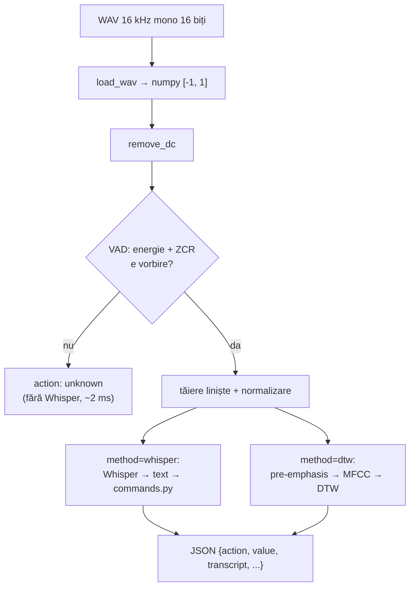

# 07 Serviciul speech

Înapoi la [[00 Start aici]] · vezi și [[01 Arhitectura generală]]

Folder: `speech/` · server Flask pe portul 5001 (intern)

## Ce face
Primește un fișier audio și întoarce **ce comandă ai spus**. E partea care se leagă direct de materie.

## Modulele

| Fișier | Rol | Notiță |
|---|---|---|
| `app.py` | serverul Flask: endpoint-urile, leagă pașii între ei | aici |
| `preprocessing.py` | citire WAV, eliminare DC, cadre, energie, ZCR, VAD, normalizare, pre-emphasis | [[08 Preprocesare și VAD]] |
| `recognizer_whisper.py` | metoda A: Whisper (speech-to-text) | [[09 Whisper și interpretarea comenzilor]] |
| `commands.py` | text → comandă (+ numere) | [[09 Whisper și interpretarea comenzilor]] |
| `features.py` | spectrogramă, MFCC | [[10 MFCC și DTW]] |
| `recognizer_dtw.py` | metoda B: MFCC + DTW cu șabloane | [[10 MFCC și DTW]] |
| `templates_audio/` | șabloanele DTW (`<comanda>/*.wav`) | [[11 Voice recorder]] |

## Lanțul din `POST /api/command`



## Endpoint-urile

| Metodă | Adresă | Ce face |
|---|---|---|
| `POST` | `/api/command?method=whisper\|dtw&preprocess=1\|0` | audio → comandă |
| `GET` | `/api/speech/health` | starea: modelul Whisper încărcat? câte șabloane DTW? |
| `GET` | `/api/speech/recordings?set=templates\|test&condition=quiet\|noise` | câte înregistrări are fiecare comandă |
| `POST` | `/api/speech/recordings?set=...&action=next&condition=...` | salvează o înregistrare ([[11 Voice recorder]]) |
| `DELETE` | `/api/speech/recordings/last?...` | „Undo last” |

`preprocess=0` dezactivează VAD-ul. Se folosește în evaluare, ca să vedem cât contează → [[12 Evaluare și grafice]].

## Răspunsul
```json
{
  "action": "timer", "value": 5,
  "transcript": "Start timer 5 minutes.", "language": "en",
  "method": "whisper", "speech_detected": true,
  "speech_ms": 1695, "processing_ms": 602
}
```
La DTW, `transcript` e de forma `"(DTW) next, distance 0.61"` și vin în plus `distance`, `threshold` și `scores`.

## Alte detalii
- **Whisper se încarcă în fundal** la pornire (un `threading.Thread`), ca serverul să pornească imediat. Până e gata, `/api/command` răspunde **503** („Speech model is still loading”).
- **Fiecare comandă primită se salvează** în `evaluation/recordings/<data>_<actiune>.wav` (variabila `SAVE_RECORDINGS_DIR`). Înregistrările sunt utile pentru grafice și pentru depanare, iar folderul e în `.gitignore`.
- `processing_ms` măsoară tot lanțul, de la citirea WAV-ului până la comandă.
