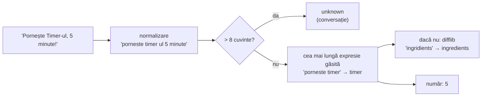

# 09 Whisper și interpretarea comenzilor

Înapoi la [[00 Start aici]] · vezi și [[07 Serviciul speech]], [[10 MFCC și DTW]]

Fișiere: `speech/recognizer_whisper.py`, `speech/commands.py`

## Metoda A: Whisper (semnal → text)
**Whisper** e o rețea neuronală de tip Transformer (encoder-decoder), făcută de OpenAI și antrenată pe ~680.000 de ore de vorbire.
- Primește semnalul la 16 kHz, își calculează singur spectrograma log-Mel și generează textul.
- Folosim biblioteca **faster-whisper**, cu modelul **`base`**, care rulează **local, pe procesor**. Doar prima dată se descarcă modelul.

Setări (`run_whisper()`):
- `compute_type="int8"`: numere pe 8 biți, deci mai rapid și mai puțină memorie
- `beam_size=1`, `temperature=0`: căutare simplă, rapidă, deterministă
- `vad_filter=False`: VAD-ul îl facem noi → [[08 Preprocesare și VAD]]
- **filtrul `no_speech_prob > 0.6`**: pe zgomot, Whisper „inventează” uneori fraze („Thank you.”), iar segmentele probabil fără vorbire se aruncă

**Limba:** detecție automată. Pe fragmente scurte poate greși (de exemplu „next” detectat ca germană). Dacă limba nu e engleză sau română, alegem dintre `en` și `ro` pe cea mai probabilă și rulăm încă o dată.

**Timp:** ~600 ms pe comandă.

## Interpretarea (text → comandă), `commands.py`

1. **Normalizare:** litere mici, **fără diacritice** (`unicodedata` NFD + eliminarea semnelor), fără punctuație.
2. **Filtru de conversație:** frazele cu mai mult de **8 cuvinte** sunt considerate vorbire normală și ignorate. Microfonul e mereu pornit.
3. **Căutarea expresiilor** din dicționarul `COMMANDS`, **cea mai lungă câștigă**: „stop timer” se alege înaintea lui „timer”, iar „inchide reteta” (exit) înaintea lui „inchide” (close).
4. **Rezervă: potrivire aproximativă** cu `difflib.get_close_matches` (similaritate ≥ 0.8), doar pe cuvinte de minimum 4 litere. Prinde greșelile mici ale lui Whisper.
5. **Numere** (doar pentru `timer`):
   - cifre: `"5"`
   - cuvinte EN / RO: `five`, `cinci`, `twenty five`, `douazeci si cinci`
   - cuvintele-număr consecutive se adună: „twenty five” = 20 + 5 (iar „and”/„si” dintre ele se sare)

## Comenzile (EN / RO)

| Acțiune | Exemple |
|---|---|
| `next` | next, next step, continue / următorul, pasul următor, înainte |
| `previous` | back, go back, previous / înapoi, pasul anterior |
| `repeat` | repeat, again / repetă, din nou |
| `read` | read, read step / citește |
| `ingredients` | ingredients / ingrediente |
| `close` | close, hide / închide, ascunde |
| `timer` | start timer [N minutes] / pornește timer [N minute] |
| `stop_timer` | stop, stop timer / oprește, oprește timer |
| `help` | help, what can I say / ajutor, ce pot spune |
| `exit` | exit, quit, go home / ieșire, acasă |

Toate stau **într-un singur loc** (`COMMANDS`), deci o expresie nouă se adaugă într-o singură listă.

**Test rapid:** `docker compose exec speech python commands.py` afișează interpretarea pentru o listă de exemple.
