# 14 Schema logică, pe înțelesul tuturor

Înapoi la [[00 Start aici]]

> Pe scurt: **vorbești → aplicația te aude → curăță sunetul → ghicește ce comandă ai spus → face acel lucru pe ecran.**
> Rețetele stau într-o bază de date, ca într-un dulap cu sertare.

---

## 1. Imaginea mare

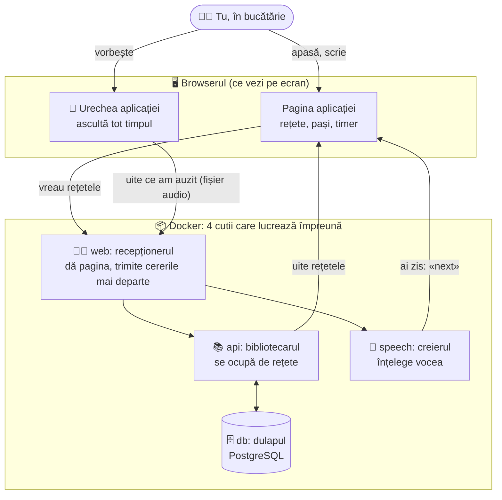

**Cine ce face:**

| Cutia | Pe înțeles | Termenul tehnic |
|---|---|---|
| **web** | recepționerul: îți dă pagina și duce fiecare cerere la omul potrivit | server nginx, reverse proxy |
| **api** | bibliotecarul: aduce, pune, schimbă și aruncă rețete | server Flask (Python), REST API |
| **db** | dulapul cu sertare unde stau rețetele | PostgreSQL |
| **speech** | creierul care ascultă și înțelege | Flask + Whisper + MFCC/DTW |

Toate patru pornesc deodată cu o singură comandă: `docker compose up`. Docker e ca un set de **cutii închise**: fiecare are înăuntru tot ce îi trebuie ca să meargă.

---

## 2. Cum ajung rețetele în PostgreSQL

### Dulapul are 3 sertare

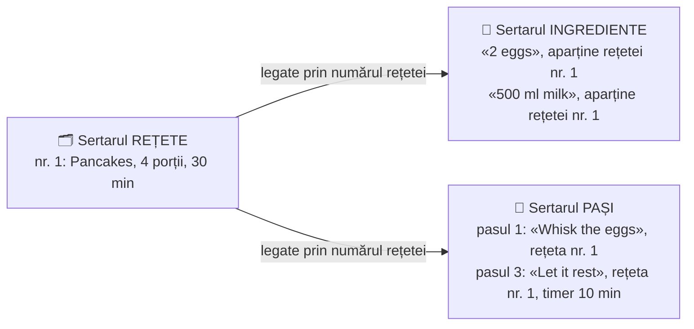

- Fiecare ingredient și fiecare pas are pe el **numărul rețetei** de care aparține, ca o etichetă.
- Dacă arunci o rețetă, se aruncă automat și ingredientele, și pașii ei. Tehnic: `ON DELETE CASCADE`.

### De unde vin datele

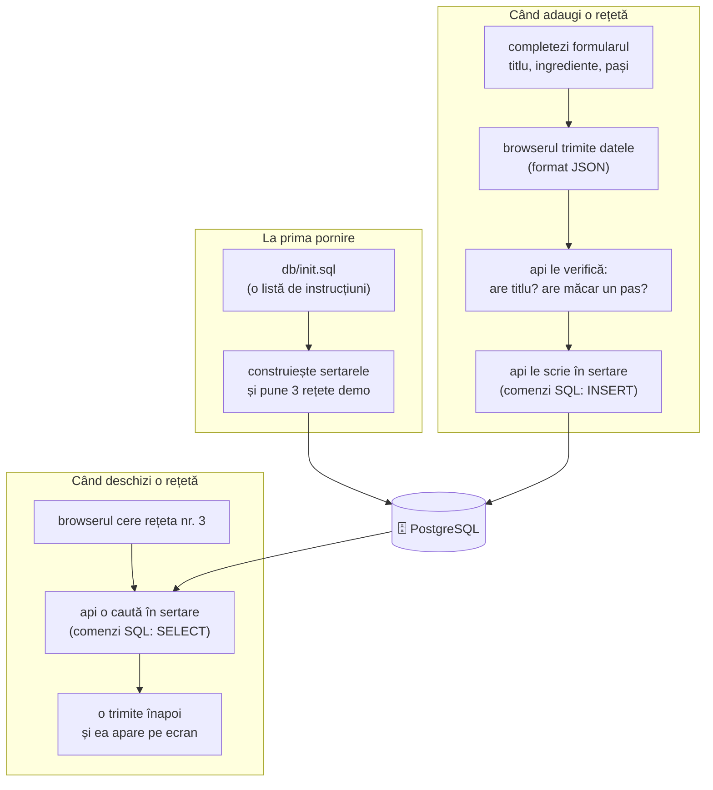

Pe scurt, bibliotecarul (`api`) vorbește cu dulapul (`db`) într-o limbă specială, **SQL**:
- **INSERT** = „pune în sertar”
- **SELECT** = „caută în sertar”
- **UPDATE** = „schimbă”
- **DELETE** = „aruncă”

Datele rămân salvate chiar dacă oprești aplicația. Tehnic: stau într-un *volum Docker*.

---

## 3. Cum e construită interfața

### O singură pagină care își schimbă conținutul

Aplicația e **o singură pagină web**. Ce vezi depinde de ce scrie după `#` în adresă:

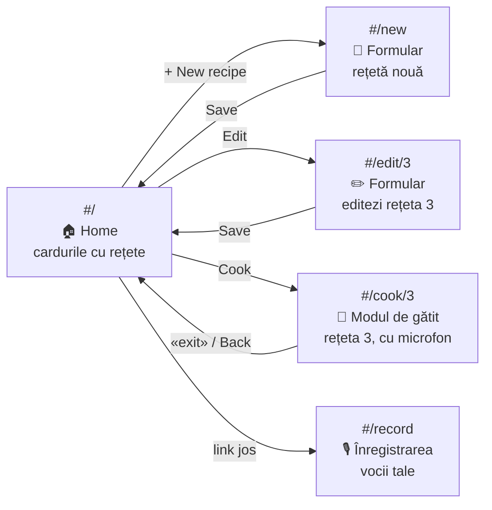

Pagina nu se reîncarcă. Doar partea din mijloc se redesenează din JavaScript. Tehnic: **SPA** (Single Page Application), cu un **router** care citește `#`.

Fișierele, pe scurt:
- `index.html` = scheletul (bara de sus + un loc gol în mijloc)
- `style.css` = hainele (culori de unt, colțuri rotunde, text mare)
- `app.js` = „dirijorul” care alege pagina
- `cooking.js` = modul de gătit
- `listener.js` = urechea
- `recorder.js` = pagina de înregistrare

### Modul de gătit: o singură „ușă” pentru toate comenzile

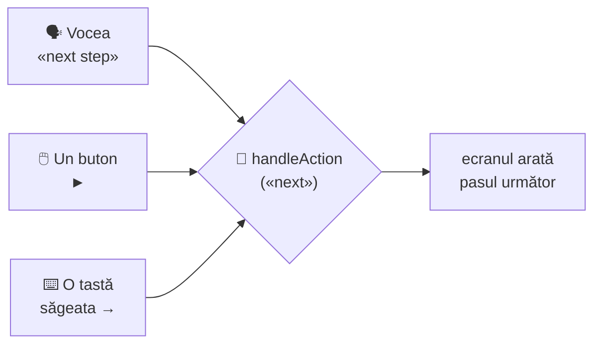

Nu contează **cum** dai comanda: vocea, butonul și tastatura intră toate pe **aceeași ușă**. De aceea vocea se poate adăuga peste o interfață care merge deja și cu click-uri.

---

## 4. Ce se întâmplă când spui „next step”

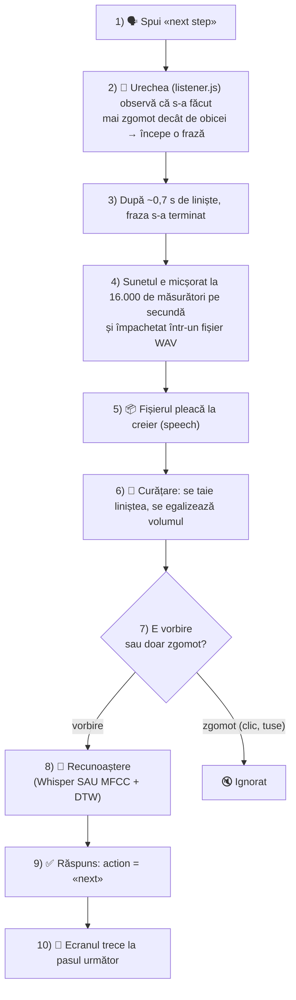

Tot drumul durează **sub o secundă**.

---

## 5. Curățarea sunetului (VAD)

**Problema:** fișierul are liniște la început și la sfârșit, iar uneori doar un zgomot (o ușă trântită). Vrem doar bucata în care cineva vorbește.

**Cum facem:** tăiem sunetul în **felii foarte subțiri, de 25 de milisecunde** (ca o pâine feliată). Pentru fiecare felie ne uităm la două lucruri:

| Măsurăm | Pe înțeles | Ce ne spune |
|---|---|---|
| **Energia** | cât de **tare** e felia | vocea e mai tare decât liniștea |
| **ZCR** (treceri prin zero) | cât de **„șuierat”** e sunetul: de câte ori unda trece de la plus la minus | „s”, „f”, „ș” sunt slabe, dar foarte șuierate |

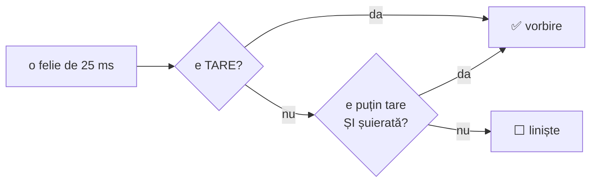

- **„Tare” e relativ la cameră.** Aplicația măsoară întâi zgomotul de fond, adică cele mai liniștite felii, și compară totul cu el.
- **La final** păstrăm doar zona dintre prima și ultima felie cu vorbire, plus o mică margine.
- **Dacă sunt sub 10 felii de vorbire** (adică sub 0,1 secunde), a fost doar un clic, deci îl ignorăm.

Tehnic: **VAD** (Voice Activity Detection), cu *energie pe termen scurt* și *zero-crossing rate*.

---

## 6. Cele două „creiere” care recunosc comanda

### 🅰️ Whisper: creierul care știe să citească

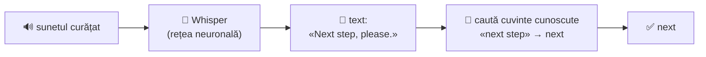

- **Ce e Whisper:** un program care a „ascultat” sute de mii de ore de vorbire și a învățat să **transforme orice frază în text**, ca un stenograf.
- **După el**, textul e comparat cu un **dicționar de comenzi** („next”, „pasul următor”, „înapoi”...). Dacă găsește una, gata.
- **Numerele** („five”, „cinci”) se transformă în cifre, pentru timer.
- **Plus:** înțelege orice formulare, în engleză și română. **Minus:** e mai lent (~0,6 s).

### 🅱️ MFCC + DTW: creierul care compară „amprente”

Metoda clasică, fără inteligență artificială. Pe scurt: **„sună la fel ca exemplele pe care mi le-ai dat?”**

**Pasul 0: îi dai exemple.** Spui fiecare comandă de 5 ori (pagina `#/record`). Acestea sunt **șabloanele**.

**Pasul 1, MFCC: „amprenta” sunetului**

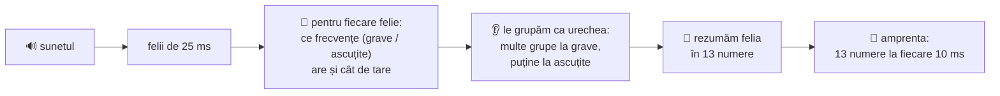

- Fiecare felie de sunet devine **13 numere** care descriu **„forma” vocii** în acel moment: ce sunet faci cu gura („a”, „e”, „s”...).
- Un cuvânt de o secundă devine un **șir de ~100 de astfel de amprente mici**.
- Tehnic, *MFCC* = Mel-Frequency Cepstral Coefficients:
  - spectrul se calculează cu FFT
  - frecvențele se grupează pe scala Mel, „ca urechea”
  - urmează logaritm, apoi DCT
- Înainte, sunetul trece printr-un filtru care **accentuează sunetele ascuțite** (consoanele). Tehnic: *pre-emphasis*.

**Pasul 2, DTW: compari două șiruri spuse cu viteze diferite**

Problema: o dată spui „neeext” rar, altă dată „next” repede. Nu le poți compara felie cu felie, pentru că nu se aliniază.

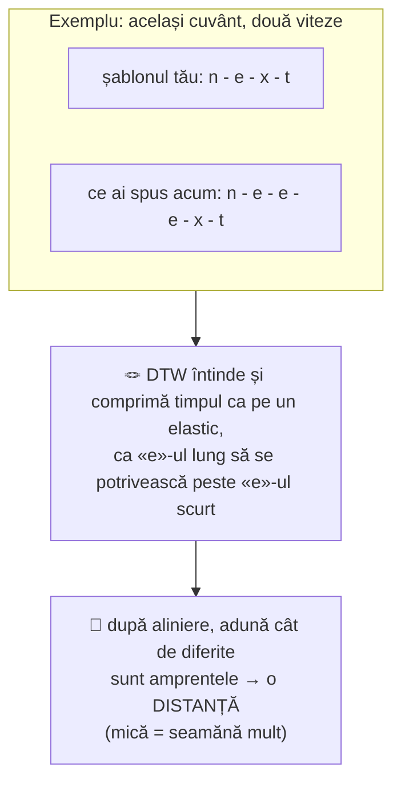

Tehnic: *Dynamic Time Warping*. Găsește drumul cel mai ieftin într-un tabel de comparații.

**Pasul 3: alegi cel mai apropiat șablon**

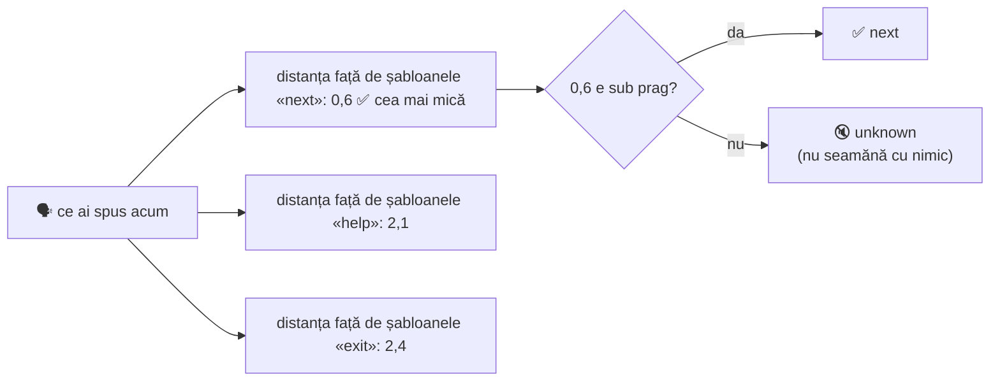

- **Câștigă comanda cu distanța cea mai mică.**
- **Pragul:** dacă nici cea mai bună nu e destul de aproape, răspunsul e „nu știu”. Pragul se calculează singur, din cât de diferit spui tu de obicei aceeași comandă.

### Comparația celor două creiere

|  | 🅰️ Whisper | 🅱️ MFCC + DTW |
|---|---|---|
| Cum gândește | transformă vocea în text, apoi citește | compară amprenta cu exemplele tale |
| Are nevoie de exemple? | nu | da, 5 pe comandă |
| Înțelege orice frază? | da | doar frazele din exemple |
| Înțelege numere („5 minutes”)? | da | nu |
| Merge pe altă voce? | da | aproape deloc |
| Viteză | ~0,6 s | ~0,03 s (de ~20 de ori mai rapid) |
| Inteligență artificială? | da (rețea neuronală) | nu (matematică clasică) |

---

## 7. Tot lanțul, într-o singură poză

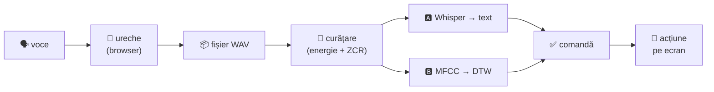

Exact asta cere tema: **semnal vocal → prelucrare → text / trăsături → comandă → acțiune în interfață.**

Detaliile fiecărei bucăți sunt în notițele [[01 Arhitectura generală]] … [[13 Rulare și depanare]].
